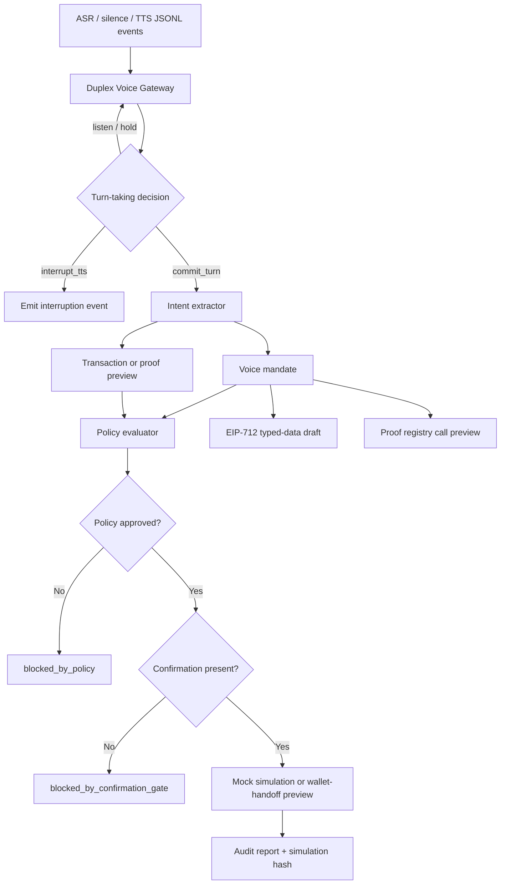

# Pharos Voice Action Gateway

> A confirmation-gated voice-to-onchain safety layer for Pharos agents.

[](https://www.python.org/)
[](LICENSE)
[](#current-boundaries)
[](https://dorahacks.io/build/44805)


Pharos Voice Action Gateway is a dependency-free reference implementation for
safer voice-driven blockchain agents. It solves two problems that are easy to
underestimate:

1. **When is a spoken instruction complete?**
2. **When is an agent actually allowed to prepare or execute an onchain
   action?**

The gateway reads timestamped speech-event fixtures, decides when an utterance
appears complete, and turns committed text into a structured Pharos action
preview. Before an action can proceed to simulation, it must pass both a
policy check and, where required, a confirmation check.

Instead of broadcasting transactions, the default demo produces inspectable
artifacts: a transaction preview, voice and intent hashes, a voice mandate,
policy results, an EIP-712-shaped typed-data payload, a proof-registry call
preview, an audit timeline, and a deterministic simulation hash.

**Try it without moving funds.** Demo mode runs entirely offline. Payment
Preview also has an optional read-only RPC mode for chain ID, balance and fee
estimation. Neither mode connects a wallet, requests a signature, or submits a
transaction.

**P0 update — October 22, 2026.** The local workspace now includes an
**Official Chain MCP** mode for Pacific Mainnet PROS/USDC/WPROS, token metadata
checks, read-only simulation, pending nonce, unsigned wallet requests and
offline proof replay. The isolated `site/` folder is a recorded evidence
viewer with three MCY-narrated, Chinese-captioned walkthroughs under `site/media/`.
The [public evidence site](https://chengyuann.github.io/pharos-voice-action-gateway/)
is deployed with all three videos. All three Arena tasks were submitted on
October 22 and are **IN REVIEW**, not yet approved or scored.
A new installed-Skill + MCP run at block 20913011 includes official
Skill `cast balance` execution and a same-block comparison gate.
See
[P0 release status](docs/p0-release-status.md) and the
[payment Skill package](skills/pharos-payment-review/SKILL.md).

[Quick start](#quick-start) |
[Payment Preview](#payment-preview) |
[Policy Gatekeeper](#policy-gatekeeper-agent-arena-build) |
[Product plan](docs/payment-agent-plan.md) |
[Watch the narrated demo](assets/demo/pharos-voice-action-gateway-demo-mimo-voiced.mp4) |
[DoraHacks submission](https://dorahacks.io/build/44805)

## Contents

- [Why this project exists](#why-this-project-exists)
- [What is implemented](#what-is-implemented)
- [Architecture](#architecture)
- [Quick start](#quick-start)
- [Payment Preview](#payment-preview)
- [Policy Gatekeeper Agent Arena build](#policy-gatekeeper-agent-arena-build)
- [Demo scenarios](#demo-scenarios)
- [Input event format](#input-event-format)
- [Output contract](#output-contract)
- [Safety model](#safety-model)
- [Agent and MCP integration](#agent-and-mcp-integration)
- [Proof registry](#proof-registry)
- [Project structure](#project-structure)
- [Current boundaries](#current-boundaries)
- [Production roadmap](#production-roadmap)
- [Hackathon background](#hackathon-background)
- [Further reading](#further-reading)
- [Contributing](#contributing)
- [License](#license)

## Why this project exists

Voice agents introduce failure modes that text interfaces do not:

- a short pause may be mistaken for the end of an instruction;
- partial ASR text may be submitted before the user finishes speaking;
- a user may interrupt TTS to correct the agent;
- a casual "yes" may be interpreted as transaction approval;
- confirmation may be treated as permission to bypass policy;
- raw audio may be retained even when only a proof is required.

Those failures become costly when an agent controls a wallet. A reliable
voice-to-onchain system therefore needs more than speech recognition. It needs
an execution boundary.

Pharos Voice Action Gateway introduces that boundary:

```text
voice events
  -> turn-taking decisions
  -> committed utterance
  -> structured intent
  -> action preview + mandate
  -> policy and confirmation checks
  -> blocked result or offline simulation / wallet-handoff preview
```

The central rule is simple:

> Human confirmation is necessary for a risky action, but confirmation alone
> is never sufficient to override safety policy.

## Payment Preview

The default page is now the **Voice Action Gateway** workspace, with a
voice-event console ahead of Payment Preview. Three local JSONL scenarios
(`Voice payment`, `Barge-in correction`, `Short pause`) run through the existing
duplex gateway and expose `listen`, `hold`, `commit_turn` and `interrupt_tts`.
Replay or step through the events, inspect fixture-only voice/intent/mandate
hashes, and explicitly copy a committed payment into the review form.

**This is event replay, not live microphone input or audio playback.** No
speech models or LLM are connected; intent candidates use the prototype's
keyword rules and may overmatch. Replay is read-only and does not persist
records, call RPC, simulate execution or carry confirmation into a new payment.
Legacy voice-mandate hashes use their original chain scope and are not bound
to the new Payment Preview draft.

Payment Preview accepts one
payment request, asks for missing amount, token or recipient details, checks the
address, configured balance and payment policy, and produces a reviewable
draft.

It has three clearly separated data sources:

- **Demo data**: a deterministic local balance and policy time. The resulting
  transaction object is labelled as an example.
- **Live network**: read-only JSON-RPC calls for chain ID, block number, native
  balance, gas estimate and gas price. The source address is supplied as a
  server environment variable; no wallet connection or ownership claim is
  made.
- **Official Chain MCP**: Pacific Mainnet PROS/USDC/WPROS; pinned balance,
  code, metadata and `eth_call`, plus pending nonce and current fee quotes.
  Select this mode explicitly; it never treats testnet PHRS as mainnet PROS.

All modes save local review and draft records under
`reports/payment_preview/`. A review expires after 10 minutes; its demo draft keeps that expiry. Changing the
request invalidates the current review. The server checks current settings and
policy again before a draft is created; live mode also reads network data
again.

### Action revisions and cancellation

The product UI uses server-side action sessions. Editing input or applying an
explicit amount correction invalidates the prior review and confirmation.
`change amount to 0.03` and `改成0.03` are supported correction forms; this is
not general conversational understanding. Cancellation blocks late review and
draft publication. Retry of an already completed draft returns the same saved
draft; simultaneous draft requests do not create duplicates.

The default HTTP service requires a per-action capability token for payment
review, confirmation, and draft creation. The old text-only HTTP review and
review-ID-only draft paths are disabled by default; compatibility tests enable
them explicitly. Tokens stay in page memory and only their digests are stored
in the local SQLite state file. A server restart revokes old action sessions.
This is local workflow protection, not user authentication or wallet authority.
Previously exported drafts cannot be recalled.

See [action lifecycle and verification](docs/action-lifecycle.md).

Run the local workspace:

```bash
python3 scripts/policy_gatekeeper_server.py
```

Open:

```text
http://127.0.0.1:8766/payment-preview
```

Optional live read-only mode:

```bash
PHAROS_RPC_URL="https://atlantic.dplabs-internal.com" \
PHAROS_READ_ADDRESS="0x3333333333333333333333333333333333333333" \
python3 scripts/policy_gatekeeper_server.py
```

Replace the example address with the full public address whose balance you want
to inspect. Do not put private keys or seed phrases in these variables.
Atlantic Testnet uses chain ID `688689`. The endpoint above is the public
endpoint listed in the Pharos network documentation as of October 20, 2026.

Atlantic demo/legacy live mode supports one native PHRS transfer at a time.
Official MCP mode adds exact configured contacts, PROS/USDC/WPROS, ERC-20
encoding, pending nonce and an unsigned wallet URI. Neither mode supports
schedules, recurring payments, wallet connection, signatures or broadcast.
Use `PHAROS_MCP_READ_ADDRESS` to configure the public address for the official
MCP mode. The default Alice/Bob contacts are placeholders, not verified people.

See [product specification](docs/payment-agent-plan.md) and
[verification record](docs/payment-preview-verification.md).

Focused tests:

```bash
python3 -m pytest \
  scripts/test_payment_preview.py \
  scripts/test_payment_preview_http.py \
  scripts/test_payment_rpc.py \
  scripts/test_payment_actions.py -q
```

The combined suite including Chain MCP and static evidence checks passed
**314 tests** on October 22, 2026. The two legacy smoke suites also passed.
Run `python3 -m pytest scripts -q` for the full suite.

## Policy Gatekeeper Agent Arena build

This repository now includes a dedicated implementation of the Pharos Season
of AI **Policy Gatekeeper** task. It applies four rules before any executor can
be reached:

- positive per-request spend limit;
- token allowlist;
- recipient allowlist;
- UTC day and time window.

Every request returns `allow` or `deny`, the deciding rule, the complete
per-rule trace, and a local JSON audit record. Invalid policy configuration
fails closed. Policy is evaluated again immediately before mock execution, so
an action prepared inside an allowed time window cannot reuse that approval
after the window closes.

Run the reviewer-facing demo:

```bash
python3 scripts/policy_gatekeeper_server.py
```

Then open:

```text
http://127.0.0.1:8766/policy-gatekeeper
```

The page includes four reproducible scenarios: allow, deny by amount, deny by
recipient, and deny by time window. Replay timestamps are available only in
mock mode and are visibly labelled. Even the allowed scenario never signs or
broadcasts a transaction.

Run the focused tests:

```bash
python3 -m pytest scripts/test_policy_gatekeeper.py scripts/test_policy_gatekeeper_http.py -v
```

The active policy is stored in
[`config/policy_gatekeeper.json`](config/policy_gatekeeper.json). Audit records
are written under `reports/policy_gatekeeper/`, which is intentionally ignored
by Git.

The [badcase review](docs/policy-gatekeeper-badcases.md) records independent
worker findings, verified fixes, and 77 passing core/HTTP tests. This local
server rejects non-loopback Host headers and is not a public production host.
Prepared-object checks detect accidental mutation, not hostile in-process
code. If an audit write fails after mock execution, the API returns the actual
result with `recorded=false`; it does not claim the mock was never called.

## What is implemented

| Capability | Current implementation |
|---|---|
| Payment Preview | Local product with editable payment form, missing-field questions, review, drafts, activity and connection settings |
| Read-only RPC | Chain ID, block, balance, gas estimate and gas price; explicit opt-in, no signing or broadcast |
| Official Chain MCP | Pacific Mainnet PROS/USDC/WPROS, pinned state, simulation, nonce and human-reviewed unsigned drafts |
| Evidence replay | Curated historical traces, offline decision verifier and isolated static proof viewer |
| Turn detection | Heuristic processing of timestamped ASR, silence, and TTS events |
| Short-pause handling | Emits `hold` while an utterance appears incomplete |
| End-of-utterance commit | Emits `commit_turn` only after completion criteria are met |
| Barge-in handling | Emits `interrupt_tts` when the user interrupts active TTS |
| Intent extraction | Deterministic parsing for payment, balance, proof, and generic intents |
| Confirmation gate | Blocks medium- and high-risk actions without explicit confirmation |
| Cancellation handling | Detects English and Chinese cancellation phrases |
| Policy checks | Payment amount, token allowlist, trusted recipient, UTC time window, mandate-hash format, and a no-audio-storage flag |
| Voice mandate | Collects event-evidence hashes, intent, action scope, and declared expiry duration |
| Readback challenge | Generates an action-specific phrase for a future strict confirmation adapter |
| EIP-712 draft | Exports a `VoiceMandate` typed-data structure for wallet integration |
| Proof artifacts | Produces voice, intent, mandate, policy, and typed-data hashes |
| Transaction adapter | Generates read-only, payment, or proof transaction previews |
| Simulation | Produces deterministic evidence without broadcasting a transaction |
| Solidity registry | Includes a minimal `VoiceSessionProofRegistry` draft for hashes and metadata |
| Agent tool contract | Exports seven tool schemas intended for an MCP/AgentSkill integration |

## Architecture



The diagram shows the logical decision path. In the current batch runner,
confirmation is detected from committed text before action preparation; the
submission stage then enforces the policy block before the confirmation block.
An interruption is an output event, not an actual audio-playback operation.

## Quick start

For the web product, run `python3 scripts/policy_gatekeeper_server.py` and open
`http://127.0.0.1:8766/`. The commands below also exercise the legacy voice demos.

### Requirements

- Python **3.9 or newer**; the documented commands were verified on Python 3.9.6
- No third-party Python packages to run the product; `pytest` is needed for tests
- No wallet, RPC endpoint, API key, or speech model required for the demos

Clone and enter the repository:

```bash
git clone https://github.com/Chengyuann/pharos-voice-action-gateway.git
cd pharos-voice-action-gateway
```

Run the complete smoke-test suite:

```bash
python3 scripts/run_demo_tests.py
python3 scripts/run_pharos_demo_tests.py
```

Expected result:

```text
PASS duplex_conversation: commit_turn + interrupt_tts
PASS short_pause_continuation: hold before commit
PASS pharos_payment_confirmed: EIP-712 mandate + policy + simulated tx
PASS pharos_payment_pending: high-risk action blocked without confirmation
PASS pharos_payment_policy_blocked: confirmation cannot bypass policy
PASS pharos_session_proof_confirmed: proof payload + MCP tool schema
PASS VoiceSessionProofRegistry.sol: registry draft present
```

Run the turn-taking gateway:

```bash
python3 scripts/duplex_voice_gateway.py demo/duplex_conversation.jsonl
python3 scripts/duplex_voice_gateway.py \
  demo/duplex_conversation.jsonl \
  --format json \
  --output duplex_report.json
```

Run a Pharos action scenario:

```bash
python3 scripts/pharos_voice_action_gateway.py \
  demo/pharos_payment_confirmed.jsonl \
  --output pharos_report.json
```

The CLI prints a short summary and writes the full report to the selected
output path. Without `--output`, it creates a timestamped report in the current
directory. Use a new filename to preserve an existing report.

The action CLI defaults to `--mode mock`. To inspect the future wallet handoff:

```bash
python3 scripts/pharos_voice_action_gateway.py \
  demo/pharos_payment_confirmed.jsonl \
  --mode wallet \
  --output wallet_report.json
```

For this approved fixture, the status becomes `ready_for_wallet_signature`.
**This is a preparation status, not a wallet connection or a signed transaction.**

## Demo scenarios

### 1. Confirmed payment

```text
User: send 0.02 PHRS to 0x1111111111111111111111111111111111111111
Agent: I prepared a Pharos payment preview. Please confirm before I submit anything.
User: wait
User: confirm execute
```

Result:

- barge-in is detected and an `interrupt_tts` event is emitted;
- the payment is within the demo limit;
- the recipient is trusted;
- explicit confirmation is detected; and
- a deterministic simulation hash is returned.

```bash
python3 scripts/pharos_voice_action_gateway.py \
  demo/pharos_payment_confirmed.jsonl
```

### 2. Missing confirmation

The user requests a `0.05 PHRS` transfer to a trusted recipient but never
confirms it.

Result: `blocked_by_confirmation_gate`.

```bash
python3 scripts/pharos_voice_action_gateway.py \
  demo/pharos_payment_pending.jsonl
```

### 3. Confirmation cannot bypass policy

The user requests a `0.50 PHRS` transfer to an untrusted recipient and then
says `confirm execute`.

Result: `blocked_by_policy`, with `amount_limit` and `recipient_trust` listed as
blocking reasons.

```bash
python3 scripts/pharos_voice_action_gateway.py \
  demo/pharos_payment_policy_blocked.jsonl
```

### 4. Voice-session proof

The user requests a proof of the voice session and confirms it.

Result:

- a proof payload is generated;
- no audio is captured or stored by the demo;
- an EIP-712-shaped mandate is exported; and
- `VoiceSessionProofRegistry.recordVoiceMandate` arguments are prepared,
  without sending a contract call.

```bash
python3 scripts/pharos_voice_action_gateway.py \
  demo/pharos_session_proof_confirmed.jsonl
```

## Input event format

The demos use JSON Lines to represent a stream from future local speech
adapters. ASR means automatic speech recognition, VAD means voice activity
detection, and TTS means text-to-speech.

Each line is a separate JSON object. `t` is a timestamp in seconds, `type`
selects the event, and `text` carries the transcript or playback text. The
loader sorts events by timestamp. ASR updates should contain the full current
hypothesis, not just the next word: each update replaces the buffered text.

```json
{"t": 0.00, "type": "asr_partial", "text": "send", "speech": true}
{"t": 0.82, "type": "asr_final", "text": "send 0.02 PHRS to 0x1111111111111111111111111111111111111111", "speech": true}
{"t": 1.62, "type": "silence", "speech": false}
{"t": 1.85, "type": "tts_start", "text": "Please confirm before I submit anything."}
{"t": 2.20, "type": "asr_partial", "text": "wait", "speech": true}
{"t": 2.50, "type": "asr_final", "text": "confirm execute", "speech": true}
{"t": 3.30, "type": "silence", "speech": false}
```

Supported event types:

| Event | Purpose |
|---|---|
| `asr_partial` | Update the current in-progress transcript |
| `asr_final` | Provide a final ASR hypothesis |
| `silence` | Measure pause duration and evaluate end-of-utterance |
| `tts_start` | Mark agent speech as active |
| `tts_end` | Mark agent speech as complete |

The `speech` flag is accepted as metadata; event dispatch and timing drive the
current heuristics. There is no separate `vad` event type. Unknown types emit
an `ignore` event. A final partial utterance needs an explicit silence event
to trigger pause-based evaluation; end-of-file does not force a commit.

Turn-taking output:

| Action | Meaning |
|---|---|
| `listen` | Continue collecting speech |
| `hold` | Preserve the partial utterance through a short or incomplete pause |
| `commit_turn` | Mark an utterance as complete according to the heuristic |
| `interrupt_tts` | Signal a playback adapter to stop TTS after a detected interruption |
| `tts_started` | Record that agent speech began |
| `tts_finished` | Record that agent speech ended |

The default end-of-utterance silence threshold is `700 ms`, with a short-pause
threshold of `280 ms`. These are heuristic inputs, not a measured latency
guarantee: text-completion and continuation cues can commit earlier or keep
waiting longer. The voice-only CLI exposes the silence threshold:

```bash
python3 scripts/duplex_voice_gateway.py \
  demo/duplex_conversation.jsonl \
  --eou-silence-ms 900
```

## Output contract

`scripts/pharos_voice_action_gateway.py` writes a JSON report with these
top-level objects:

| Field | Description |
|---|---|
| `voice` | Committed turns, interruptions, and turn-taking events |
| `intent` | Parsed action, heuristic confidence, summary, parameters, risk, and intent hash |
| `confirmation` | `confirmed`, `pending_confirmation`, `cancelled`, or `not_required` |
| `prepared_action` | All artifacts prepared before submission |
| `submission` | Policy or confirmation block, simulation result, or wallet-ready status |
| `mcp_tools` | Tool schema catalog for agent orchestration |

Important `prepared_action` fields:

| Field | Description |
|---|---|
| `transaction_preview` | Read-only query, payment transfer, proof write, or generic summary preview |
| `proof_payload` | Voice hash, intent hash, mandate hash, action ID, and timestamps |
| `mandate` | Scoped evidence with a declared five-minute expiry duration, not an enforced deadline |
| `policy_decision` | Individual checks, blocking reasons, and policy hash |
| `challenge` | Generated readback phrase tied to the action and mandate |
| `audit_timeline` | Ordered record from voice events through policy and confirmation |
| `eip712` | EIP-712-shaped `VoiceMandate` payload and deterministic demo hash |
| `registry_call` | `recordVoiceMandate` arguments and calldata signature preview |

For the confirmed-payment fixture, the key decisions are:

| Report path | Value |
|---|---|
| `intent.action` | `send_payment` |
| `intent.params.amount` | `"0.02"` |
| `voice.interrupts` | `1` |
| `confirmation.status` | `confirmed` |
| `prepared_action.policy_decision.decision` | `approved_for_confirmation` |
| `prepared_action.eip712.signature_status` | `unsigned_demo_payload` |
| `submission.status` | `simulated` |

The generated `tx_hash` is a **simulation identifier** in both modes, not a
network transaction hash. The `pharos://tx/` value is a demo URI, not a public
explorer link. Stable decision artifacts and simulation hashes are repeatable
for the same input and configuration; report timestamps change between runs.

## Safety model

### Default demo policy

```text
Maximum single payment: 0.05 token units (PHRS in the payment fixtures)
Allowed tokens: PHRS, PROS, USDC, USDT
Trusted recipients:
  0x1111111111111111111111111111111111111111
  0x2222222222222222222222222222222222222222
Raw audio stored: no
Private keys stored: no
Transaction broadcast: no
```

These defaults live in `DEFAULT_POLICY` in
[`scripts/pharos_voice_action_gateway.py`](scripts/pharos_voice_action_gateway.py).
The limit is the same raw amount for every allowed token; it is not a
price-normalized spending limit. The example recipients are fixtures, not
recommended payment destinations.

### Submission decisions

1. If any policy check fails, return `blocked_by_policy`.
2. Otherwise, if required confirmation is absent or cancelled, return
   `blocked_by_confirmation_gate`.
3. Otherwise, return `simulated` in mock mode or
   `ready_for_wallet_signature` in wallet mode.

This separation matters. A user can confirm an action and still receive
`blocked_by_policy`.

### Privacy properties

The demo:

- consumes text events rather than raw microphone audio;
- hashes structured event evidence;
- keeps raw audio out of the mandate and proof registry;
- never requests or stores a private key; and
- in the legacy voice and Demo modes, never sends data to an external API.
  Optional network modes send public addresses and transfer
  parameters (not the request text) to the configured read-only RPC or official
  Pharos Chain MCP.

Production adapters should preserve the same privacy boundary.

**Reports still contain sensitive text.** Committed transcripts, intent
`raw_text`, event text, and confirmation text remain in the local JSON report.
Redact them before publishing a report. The `voice_hash` fingerprints
structured text-event evidence, not a recording or a speaker's identity.

## Agent and MCP integration

The **outbound official Chain MCP client is implemented** in
`scripts/pharos_mcp.py`. Payment composition and replay live in
`scripts/payment_chain.py` and `scripts/payment_proof.py`. This is distinct from
the legacy gateway's proposed inbound tool catalog below.

The report includes a catalog of seven tool schemas:

| Tool | Responsibility |
|---|---|
| `process_voice_events` | Convert ASR/VAD/TTS events into turn-taking decisions |
| `prepare_onchain_action` | Build a Pharos action preview and proof payload |
| `confirm_action` | Capture explicit approval for an action ID |
| `evaluate_voice_policy` | Evaluate limits, allowlists, recipients, and evidence |
| `submit_transaction` | Simulate or hand off an approved action |
| `write_session_proof` | Prepare hash-only voice-session evidence |
| `export_eip712_voice_mandate` | Export typed data for a future signer |

These definitions are currently **schemas embedded in the report**, not a
networked MCP server. They describe intended tool responsibilities, not seven
ready-to-call endpoints. A runtime integration must implement handlers, input
validation, action state, and authorization before registering the tools.

For local integration, call the existing batch runner from the repository root:

```python
from pathlib import Path
import sys

sys.path.insert(0, str(Path("scripts").resolve()))
from pharos_voice_action_gateway import run

result = run(Path("demo/pharos_payment_confirmed.jsonl"), mode="mock")
print(result.intent["action"])
print(result.prepared_action["policy_decision"]["decision"])
print(result.submission["status"])
```

This prints `send_payment`, `approved_for_confirmation`, and `simulated`.

## Proof registry

[`contracts/VoiceSessionProofRegistry.sol`](contracts/VoiceSessionProofRegistry.sol)
is a minimal Solidity draft for recording evidence hashes on an EVM-compatible
network.

It stores:

- action ID and action type;
- voice, intent, mandate, policy, and challenge hashes;
- subject and submitter;
- timestamp; and
- optional signature bytes.

It intentionally does **not** store:

- raw audio;
- full transcripts;
- private keys;
- wallet credentials; or
- the complete offchain policy document.

The contract uses Solidity `^0.8.24`. It rejects empty mandate hashes and
prevents the same mandate hash from being recorded twice. It accepts arbitrary
callers and stores signature bytes **without verifying them**. Recording a
hash does not prove user consent, authenticate a speaker, or authorize payment.

Use `prepared_action.registry_call` when inspecting the included contract's
interface. The proof scenario's older `transaction_preview.method` refers to
`recordVoiceIntent`, which does not exist in this contract. Neither preview
contains encoded, ready-to-submit calldata.

## Project structure

```text
.
|-- assets/
|   |-- cover.jpg
|   |-- architecture.svg
|   `-- demo/
|       `-- pharos-voice-action-gateway-demo-mimo-voiced.mp4
|-- contracts/
|   `-- VoiceSessionProofRegistry.sol
|-- demo/
|   |-- duplex_conversation.jsonl
|   |-- short_pause_continuation.jsonl
|   |-- pharos_payment_confirmed.jsonl
|   |-- pharos_payment_pending.jsonl
|   |-- pharos_payment_policy_blocked.jsonl
|   `-- pharos_session_proof_confirmed.jsonl
|-- docs/
|-- references/
|-- scripts/
|   |-- duplex_voice_gateway.py
|   |-- pharos_voice_action_gateway.py
|   |-- run_demo_tests.py
|   `-- run_pharos_demo_tests.py
|-- README.md
|-- SKILL.md
`-- LICENSE
```

## Current boundaries

This repository is a safety-layer prototype, not a production wallet.

- It accepts JSONL speech events; it does not capture microphone audio.
- It does not bundle ASR, VAD, end-of-utterance, or TTS models.
- Intent extraction and confirmation detection are keyword/regex heuristics,
  not a trained language model or a secure consent protocol. Confidence
  values are fixed labels, not calibrated probabilities.
- All committed turns are combined into one intent. The runner is not a
  multi-action dialogue manager and does not securely bind a later approval
  to a particular pending action.
- The generated challenge phrase is included for integration, but the current
  parser does not require the user to repeat the full phrase.
- The typed-data object follows an EIP-712 structure, but the dependency-free
  demo hash is SHA-256 over canonical JSON, not the canonical EIP-712 signing
  digest.
- The zero address is used as the placeholder verifying contract.
- Mandate expiry is metadata only. The demo has no enforced expiration,
  action nonce, speaker authentication, or production replay protection.
- The legacy voice-action report still uses its original prototype chain ID
  `688688`. Payment Preview demo/legacy live mode uses Atlantic chain `688689`.
  The separate **Official Chain MCP** mode enforces Pacific Mainnet `1672`.
- Atlantic demo/live mode supports native PHRS. Official MCP mode supports
  PROS/USDC/WPROS, on-chain metadata checks and ERC-20 calldata.
- Network modes are read-only. Official MCP mode fetches a pending nonce and
  prepares an unsigned wallet request after confirmation. Neither mode proves
  ownership, connects a wallet, signs or broadcasts.
- Fee and balance reads are snapshots. A wallet must independently recheck
  network, nonce, balance and fees before any later signing implementation.
- `--mode wallet` returns `ready_for_wallet_signature`; it does not sign or
  broadcast.
- The Solidity contract is a draft and is not deployed by this repository.
- The included Python tests verify behavior and contract presence; they do not
  compile or audit the Solidity contract.

The demo boundary keeps the product reproducible. The unfinished ownership,
authorization and signing features still need implementation and review before
it is suitable for real assets.

## Production roadmap

The next step is to harden the authorization boundary before adding live
execution. The following work is planned, not included in this release:

| Area | Next steps |
|---|---|
| Speech adapters | Connect local VAD, ASR, and interruptible TTS; evaluate model-based end-of-utterance detection and optional OpenVINO acceleration |
| Intent and consent | Add structured intent validation, per-action confirmation, strict readback checks, nonces, enforced expiry, and configurable policy |
| Wallet handoff | Add canonical EIP-712 signing and secure wallet ownership validation; unsigned mainnet encoding, simulation and fee estimates already exist |
| Evidence registry | Reconcile preview interfaces; add signature validation, replay protection, contract tests, and a security review before deployment |
| Agent runtime | Validate the Skill package inside the hosted Pharos runtime; outbound Chain MCP already exists; add inbound MCP handlers only when needed |

## Hackathon background

The project was submitted to the
[Pharos Skill-to-Agent Dual Cascade Hackathon](https://dorahacks.io/build/44805)
as **Pharos Voice Action Gateway** and later evolved into
**Pharos Voice Safety Agent** for the Agent Arena.

- [DoraHacks submission](https://dorahacks.io/build/44805)
- [Source repository](https://github.com/Chengyuann/pharos-voice-action-gateway)

The repository includes the local Payment Preview product and the legacy
offline gateway. Historical references to an Agent Arena entry are not
evidence of Season of AI registration. As of the October 21 check, current
GitHub OAuth consent was pending; account/submission status remains unconfirmed.

## Further reading

Some supporting documents retain the project's original Chinese text.

- [Skill definition and integration guidance](SKILL.md)
- [DoraHacks submission narrative](docs/dorahacks-submission.md)
- [Design article](docs/article.md)
- [ModelScope speech-stack research](references/modelscope-voice-stack.md)
- [Research positioning](docs/research-positioning.md)

For the current implementation status, use this README and the source code.
Earlier submission materials describe some planned capabilities alongside
the prototype.

## Contributing

Issues and pull requests are welcome, particularly for:

- speech adapter interfaces;
- stricter confirmation protocols;
- policy-engine improvements;
- canonical EIP-712 signing support;
- Solidity tests and audits; and
- Pharos wallet, RPC, MCP, and explorer integrations.

Please preserve the project's core invariant: no high-risk action may proceed
unless both policy and explicit user authorization succeed.

## License

Licensed under the [Apache License 2.0](LICENSE).
